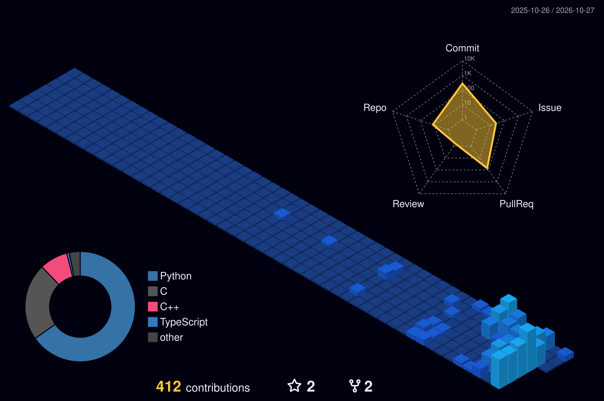

<picture>
  <source media="(prefers-color-scheme: dark)" srcset="./assets/banner-dark.svg">  
  <source media="(prefers-color-scheme: light)" srcset="./assets/banner-light.svg">  
  
</picture>

aerospace eng @ kent state. from Bulgaria 🇧🇬

---

**[specter-x](https://github.com/overlordxrz-source/specter-x)**
open-source handheld multisensor fusion: low-light, thermal, 60 ghz radar and wi-fi sensing on a pi 5, every overlay traceable to its sensor


**[oracle](https://github.com/overlordxrz-source/oracle)**
free satellite osint. ask it something and it goes and looks

**[finderx](https://github.com/overlordxrz-source/finderX)**
point at the sky, find what nobody named yet

---

**[throng](https://github.com/overlordxrz-source/throng)**  
can language show up when the only reward is staying alive  
predator vs prey on a torus, mappo. prey are half blind and talk through 3 tiny vq codebooks  
no reward for talking, so whatever words stick actually mean something  
`multi-agent rl` `emergent comms` `pytorch`

**[oracle](https://github.com/overlordxrz-source/oracle)**  
free satellite osint. ask it something and it goes and looks  
8 imagery archives. ships, planes, vehicles, tracked across dates and radar. dark vessels, loitering, ship-to-ship meetups, new construction, floods  
every claim points back to the exact image  
no accounts, no keys, no paid data  
`sentinel-1/2` `yolo` `alphaearth` `llm agents`

**[finderx](https://github.com/overlordxrz-source/finderX)**  
point at the sky, find what nobody named yet  
gaia dr3 sources simbad never classified, ml outliers, fast movers, quasar candidates, passing asteroids  
`gaia dr3` `isolation forest` `flask`

---

**ps5 emulation**  
i work on [anyps5](https://github.com/boykopovar/AnyPS5) and [kytyps5](https://github.com/KytyPS5/KytyPS5)  
kernel semantics, x86 relinking, vulkan, shaders, wtv 

```
          .        *                  .            .
   *              .      .--~~~~~--.         *
        .            .-'   .-----.   '-.                .
                    /    .'       '.    \       .
   ---======-------|====|=========|====|-------======---
                    \    '.       .'    /
     .               '-.   '-----'   .-'         *
            *            '--~~~~~--'        .
                                          a = 0.7
```

<picture>
  <source media="(prefers-color-scheme: dark)" srcset="./profile-3d-contrib/profile-night-view.svg">  
  <source media="(prefers-color-scheme: light)" srcset="./profile-3d-contrib/profile-gitblock.svg">  
  
</picture>

<picture>
  <source media="(prefers-color-scheme: dark)" srcset="https://raw.githubusercontent.com/overlordxrz-source/overlordxrz-source/output/snake-dark.svg">  
  <source media="(prefers-color-scheme: light)" srcset="https://raw.githubusercontent.com/overlordxrz-source/overlordxrz-source/output/snake.svg">  
  
</picture>

[x](https://x.com/ovrlrdx) · overlordxrz@gmail.com
